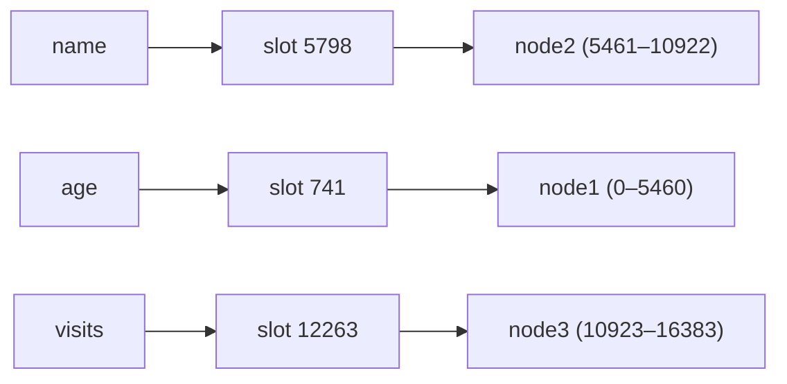
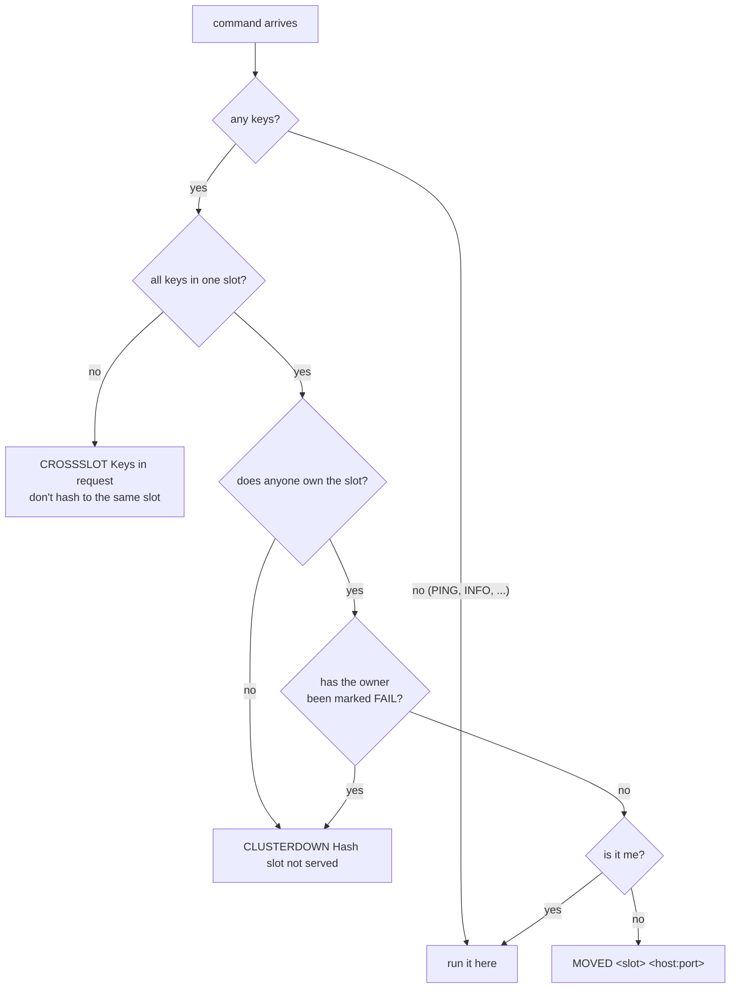

# Cluster mode

In cluster mode, several Rediska nodes split the keys between them, the way
Redis Cluster does. Each node holds only its share, and clients are sent to
the right node.

!!! info "Current scope"
Every node starts from a layout file. After that, nodes talk over the
[cluster bus](#the-cluster-bus): they learn each other's slots, add nodes
with [`CLUSTER MEET`](#adding-a-node-with-cluster-meet), and
[agree when a node has failed](#failure-detection). Slots can't move while
running yet, and there are no replicas or failover. See
[Limitations](#limitations).

## Slots

Every key belongs to one of **16384 hash slots**:

```
slot = CRC16(key) mod 16384
```

Each node owns some of the slots, and stores only the keys in them.



There are far more keys than slots, so each slot holds many keys. Slots are
the unit that gets assigned to nodes (and, in a later phase, moved between
them), so the cluster map stays small: 16384 entries, however many keys you
have.

```console
$ redis-cli -p 7001 cluster keyslot name
(integer) 5798
```

### Hash tags

If a key contains `{...}`, only the part inside the braces is hashed. Keys
with the same tag always land in the same slot:

```console
$ redis-cli -p 7001 cluster keyslot {user1}.name
(integer) 8106
$ redis-cli -p 7001 cluster keyslot {user1}.email
(integer) 8106
```

Use hash tags for keys you need to use together in one command or
transaction.

## The layout file

Every node starts from the same layout file, which lists every node, its
address and the slots it owns:

```text title="cluster.conf"
# name   address          slots
node1  127.0.0.1:7001  0-5460
node2  127.0.0.1:7002  5461-10922
node3  127.0.0.1:7003  10923-16383
```

- Slots can be ranges (`0-5460`) or single slots (`42`), several per line.
- Anything after `#` is a comment.
- A node finds **its own** line by matching its `--port`.
- Any mistake (overlapping slots, a slot above 16383, a duplicate name or
  address, no line for this node's port) stops the node at startup, naming
  the line.
- Slots that no line lists are _unowned_: commands on them get
  `CLUSTERDOWN`, while every other slot keeps working.

Start each node with the same file and its own port:

```bash
rediska --port 7001 --cluster-enabled --cluster-config-file cluster.conf
rediska --port 7002 --cluster-enabled --cluster-config-file cluster.conf
rediska --port 7003 --cluster-enabled --cluster-config-file cluster.conf
```

Each node also listens on its client port + 10000 (here 17001–17003) for the
[cluster bus](#the-cluster-bus), so those ports must be free too.

A node takes **its own** slots from the file. It learns every other node's
slots from that node, over the bus, a moment after they connect: a node
only ever speaks for its own slots.

### The cluster script

`scripts/cluster.sh` does all of that for you:

```bash
./scripts/cluster.sh start     # build, write the layout, start the nodes
./scripts/cluster.sh status    # which nodes are running, and their key counts
./scripts/cluster.sh stop      # stop them; data stays in each node's AOF
./scripts/cluster.sh clean     # stop and delete all their files
```

Files go in `/tmp/rediska-cluster/`. `NODES=4 ./scripts/cluster.sh start`
starts 4 nodes with the slots split evenly (run `clean` first if you change
the number of nodes). The script starts nodes with a 3-second
[node timeout](#failure-detection), so failures show up quickly; set
`NODE_TIMEOUT` (in milliseconds) to change it.

## How a command is routed

Before running a command, a node checks its keys, in the same order as
Redis:



The error texts match Redis 7 word for word, so clients that understand
Redis Cluster understand Rediska:

```console
$ redis-cli -p 7001 set name vinay
(error) MOVED 5798 127.0.0.1:7002
$ redis-cli -c -p 7001 set name vinay
-> Redirected to slot [5798] located at 127.0.0.1:7002
OK
$ redis-cli -p 7001 del age name
(error) CROSSSLOT Keys in request don't hash to the same slot
```

`redis-cli -c` follows `MOVED` redirects for you. In a pipeline, each
command gets its own reply, in order.

## The cluster bus

Every node opens a second port for other nodes, at its client port + 10000
(7001 → 17001). Clients never use it.

Over the bus, each node:

- connects to every node it knows (from `cluster.conf`, `CLUSTER MEET` or
  gossip), retrying every second if one isn't up yet
- sends each connected node a `PING` once a second, and answers every `PING`
  with a `PONG`
- notices when a connection closes, shows that node as `disconnected`, and
  reconnects by itself when it comes back
- takes each node's slots from what that node announces
- learns about new nodes from gossip, and
  [detects failed nodes](#failure-detection)

Messages use RESP, the same format as client commands. Each one is an array
of 7 items: type (`PING`, `PONG`, `MEET` or `FAIL`), the sender's ID, name,
address and flags, the sender's own slots (as start/end pairs), and a gossip
section: a few other nodes the sender knows, each with its flags and
ping/pong times. You can talk to the bus by hand:

```console
$ (printf '*7\r\n$4\r\nPING\r\n$1\r\nx\r\n$4\r\ntest\r\n$14\r\n127.0.0.1:9999\r\n:0\r\n*0\r\n*0\r\n'; sleep 1) | nc localhost 17001
```

The reply is a `PONG` carrying node1's ID, name, address and slots
(`0 5460`), and some gossip. node1 doesn't add the sender or act on what it
says, because it doesn't know it: only a `MEET` can introduce a new node.

Bus work runs on the same goroutine as client commands, so cluster state,
like the data, needs no locks. See
[Goroutines in a cluster node](design-decisions.md#goroutines-in-a-cluster-node)
for which goroutine does what.

## Adding a node with CLUSTER MEET

`CLUSTER MEET ip port` (the node's client port) introduces a node to the
cluster. You only need to tell **one** node; gossip tells the rest.

```console
$ redis-cli -p 7001 cluster meet 127.0.0.1 7004
OK
```

What happens next:

1. node1 adds node4 in `handshake` (it doesn't know node4's ID yet),
   connects to its bus port and sends a `MEET`.
2. node4 doesn't know node1, but a `MEET` is allowed to introduce a node,
   so it adds node1, connects back, and answers with a `PONG`.
3. node1 gets the `PONG` on the connection it opened, learns node4's real
   ID, and trusts it from then on.
4. node1's next PINGs to node2 and node3 gossip about node4. They don't
   know it, so each does its own handshake with node4.

A second or two later, every node's `CLUSTER NODES` lists all four.

Two rules keep strangers out:

- **Only a `MEET` adds a node we don't know.** A node that gossip mentions
  gets a handshake first.
- **A node is trusted only once it answers on a connection we opened.**
  Anyone can claim an address in a message; only the node really there can
  answer. A node in handshake that never answers is forgotten after 10
  seconds.

Each node gossips about a tenth of the nodes it knows (at least 3), picked
at random for each message, so no message lists the whole cluster, yet
everyone hears about everyone within a few rounds.

!!! note
    Every line in `cluster.conf` must own at least one slot, so for now a
    new node has to start with slots no other node owns. Nodes learned by
    `MEET` aren't saved to disk: a node that restarts has forgotten them
    until they reconnect to it (their first message is always a `MEET`).

## Failure detection

Nodes agree that a node has failed in two stages, as in Redis:

| Stage | `CLUSTER NODES` | Meaning |
| --- | --- | --- |
| **PFAIL** | `master,fail?` | **This** node hasn't heard from it for longer than `--cluster-node-timeout`. One node's suspicion; nothing changes for clients. |
| **FAIL** | `master,fail` | A majority of masters agree. Keys in its slots get `CLUSTERDOWN`. |

Here's what happens when node3 stops, with a 3-second timeout:

1. node1's connection to node3 closes, and node1 starts the clock. Its
   reconnect attempts fail.
2. 3 seconds later, node1 marks node3 **PFAIL**. node2 does the same.
3. Every PING now carries that suspicion: gossip always includes the
   nodes the sender suspects. Each one counts as a **failure report**.
4. node2 suspects node3 itself and has node1's report: 2 of the 3 masters,
   a majority. It marks node3 **FAIL** and sends a `FAIL` message to every
   node, so they mark it at once.
5. When node3 comes back and answers a PING, each node clears PFAIL and
   FAIL.

```console
$ redis-cli -p 7001 cluster nodes
...  127.0.0.1:7003@17003 master,fail - 1793307217542 1793307216796 3 disconnected 10923-16383
$ redis-cli -p 7001 cluster info
cluster_state:fail
cluster_slots_assigned:16384
cluster_slots_ok:10923
cluster_slots_pfail:0
cluster_slots_fail:5461
...
$ redis-cli -p 7001 get foo
(error) CLUSTERDOWN Hash slot not served
```

Why a majority: one node's own network link might be the problem. If only
node1 can't reach node3, node2 still hears node3 fine, never reports it,
and node3 never becomes FAIL. And the two halves of a split network can't
both declare the other dead. A report counts for twice the node timeout,
so old suspicions fade once a node stops repeating them.

With only **two** masters, a survivor can never reach a majority alone, so
the other node stays `fail?`. Redis behaves the same way.

The timeout is `--cluster-node-timeout`, in milliseconds. The default is
15000, as in Redis; `scripts/cluster.sh` uses 3000.

## Transactions

All keys in a `MULTI`/`EXEC` transaction must be in **one slot**, owned by
the node you're connected to. Rediska checks this in two places, as Redis
does:

**While queuing**, each command is checked on its own. If one fails, the
transaction is marked broken and `EXEC` refuses to run anything:

```console
127.0.0.1:7001> multi
OK
127.0.0.1:7001(TX)> set age 30
QUEUED
127.0.0.1:7001(TX)> set name vinay
(error) MOVED 5798 127.0.0.1:7002
127.0.0.1:7001(TX)> exec
(error) EXECABORT Transaction discarded because of previous errors.
```

**At `EXEC`**, all the queued keys are checked together. This catches
commands that are fine on their own but use different slots:

```console
127.0.0.1:7001> multi
OK
127.0.0.1:7001(TX)> set age 30
QUEUED
127.0.0.1:7001(TX)> set foo2 x
QUEUED
127.0.0.1:7001(TX)> exec
(error) CROSSSLOT Keys in request don't hash to the same slot
```

`age` (slot 741) and `foo2` (slot 1044) are both on node1, but in different
slots, so the transaction is refused. Either way, a transaction never runs
halfway. Use hash tags to keep a transaction's keys together:

```console
127.0.0.1:7002> multi
OK
127.0.0.1:7002(TX)> set {user1}.name vinay
QUEUED
127.0.0.1:7002(TX)> incr {user1}.visits
QUEUED
127.0.0.1:7002(TX)> exec
1) OK
2) (integer) 1
```

## CLUSTER commands

| Command                            | Returns                                                    | Used by                                            |
| ---------------------------------- | ---------------------------------------------------------- | -------------------------------------------------- |
| `CLUSTER KEYSLOT key`              | the key's slot                                             | debugging                                          |
| `CLUSTER COUNTKEYSINSLOT slot`     | how many of **this node's** keys are in the slot           | checking how data is spread; moving slots          |
| `CLUSTER GETKEYSINSLOT slot count` | up to `count` of this node's keys in the slot              | moving slots                                       |
| `CLUSTER SLOTS`                    | slot ranges and their owners                               | client libraries, to learn the map                 |
| `CLUSTER NODES`                    | one line per node                                          | `redis-cli --cluster`, `redis-benchmark --cluster` |
| `CLUSTER MYID`                     | this node's 40-character ID                                | debugging                                          |
| `CLUSTER INFO`                     | `cluster_state:ok` if every slot has a working owner, plus counts | monitoring                                  |
| `CLUSTER MEET ip port`             | `OK`, then the node joins by handshake and gossip          | adding a node                                      |

`INFO cluster` reports `cluster_enabled:1` on a cluster node.

`COUNTKEYSINSLOT` and `GETKEYSINSLOT` answer about the node you ask, whoever
owns the slot, and never redirect:

```console
$ redis-cli -p 7002 cluster countkeysinslot 8106
(integer) 3
$ redis-cli -p 7002 cluster getkeysinslot 8106 10
1) "{user1}.name"
2) "{user1}.email"
3) "{user1}.visits"
$ redis-cli -p 7001 cluster countkeysinslot 8106
(integer) 0
```

To answer these quickly, each cluster node keeps a small index of which of
its keys are in each slot, next to its data. It's updated whenever a key is
created or removed (including by expiry and eviction), and it's switched off
on a normal single node.

Node IDs are derived from the node's name, so they stay the same across
restarts.

In `CLUSTER NODES`, the ping-sent and pong-received columns come from the
[cluster bus](#the-cluster-bus). They are Unix times in milliseconds (`0`
means none pending, or never), and the link state is `connected` or
`disconnected`. Run it twice: on a healthy cluster, the pong times move
forward every second.

The flags column shows `myself` on the node you asked, `handshake` for a
node that hasn't answered yet, and `fail?` or `fail` for a node this node
suspects or the cluster agreed has failed (see
[Failure detection](#failure-detection)). In `CLUSTER INFO`,
`cluster_slots_pfail` and `cluster_slots_fail` count those nodes' slots,
and `cluster_state` is `fail` while any slot is unowned or owned by a FAIL
node.

### Tools that work

- `redis-cli -c`: follows redirects.
- `redis-cli --cluster check 127.0.0.1:7001`: reports all 16384 slots
  covered.
- `redis-benchmark --cluster -p 7001`: spreads load across the nodes.

Some client libraries also need commands Rediska doesn't have yet. For
example, redis-py's cluster client reads the slot map, then calls `COMMAND`.

## Persistence in a cluster

Each node has its own AOF, holding only its own keys. When a node restarts,
it loads its whole AOF back **without** the cluster check, so its data is
never dropped, even if the layout file changed while it was down.

## Limitations

- **Nothing is saved**: nodes don't write what they learn to a
  `nodes.conf`. A node that restarts knows only `cluster.conf` until the
  others reconnect to it, and if every node restarts, nodes added with
  `CLUSTER MEET` are gone.
- **No empty nodes**: every `cluster.conf` line must own at least one slot.
- **No slot migration**: slots can't move between running nodes, and if
  two nodes claim the same slot, the first owner keeps it (no config
  epochs yet).
- **No replicas or failover**: a FAIL node's slots get `CLUSTERDOWN` until
  it comes back.
- **Every node PINGs every node once a second**: fine for a few nodes;
  Redis's schedule (about one random node a second) scales better.
