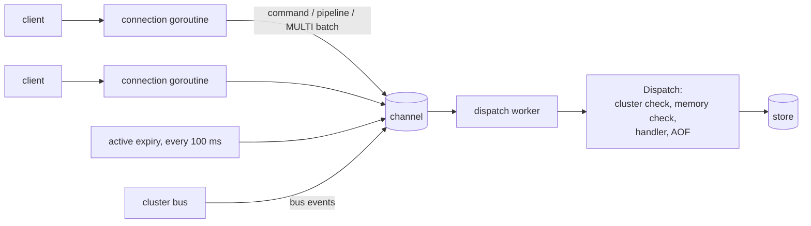
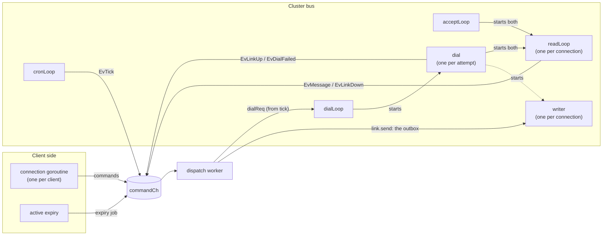
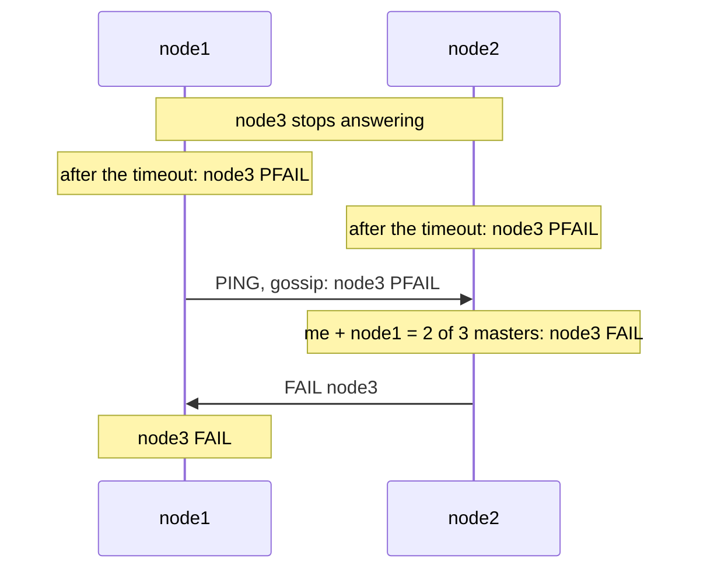

# Design decisions

Why Rediska is built the way it is. Each section says what was chosen,
why, and what it costs.

## How a command flows

1. Each client connection has its own goroutine. It reads and parses RESP,
   handles `MULTI` queuing, and groups pipelined commands.
2. Every command that touches data is sent over one channel to a single
   **dispatch worker**.
3. The worker runs commands one at a time: cluster check, memory check,
   the command's handler, then the AOF write. The reply goes back to the
   connection.
4. In cluster mode, the [cluster bus](cluster.md#the-cluster-bus) sends its
   events over the same channel, so the worker also runs the bus's
   decisions, between commands (see
   [Goroutines in a cluster node](#goroutines-in-a-cluster-node)).

## One worker goroutine for all data

**Choice:** every command runs on one goroutine, like Redis's single
thread, instead of locking the store.

**Why:** no locks in the store at all, and commands are atomic for free:
nothing can interleave with a command, or with an `EXEC` batch. It also
mirrors how Redis really works, which is the point of the project.

**Cost:** one CPU core does all the data work. The channel was the main
bottleneck under pipelined load, which is why pipelined commands are now
sent to the worker as one batch (see [Performance](performance.md)).

## Compact value encodings

**Choice:** like Redis, a value is stored as a number (`int`) if it parses
as one, and as a string (`embstr` up to 44 bytes, `raw` above) otherwise.
Each stored value is a small tagged struct, not a Go `any`.

**Why:** saves memory, and avoids an allocation per `SET` that boxing into
an interface would cost. `OBJECT ENCODING` shows which one a key uses.

## Approximate LRU and LFU by sampling

**Choice:** eviction samples a few keys (`--maxmemory-samples`, default 5)
and evicts the best candidate from a small pool, like Redis.

**Why:** exact LRU needs a linked list across every key, which costs memory
and time on every access. Sampling gets close to exact behaviour at a tiny
cost, which is why Redis does it.

## Cluster mode

### Copy Redis Cluster's design

**Choice:** 16384 slots, CRC16 hashing, `{hash tags}`, `MOVED` and
`CROSSSLOT`, and the `CLUSTER` commands, all matching Redis 7's formats
word for word.

**Why:** existing tools (`redis-cli -c`, `redis-benchmark --cluster`,
`redis-cli --cluster check`) work against Rediska unchanged, and each piece
maps to a part of Redis you can read about.

### A layout file to start from, gossip after that

**Choice:** every node reads `cluster.conf` at startup, to know which nodes
to connect to and which slots it owns itself. After that, the bus takes
over: other nodes' slots come from those nodes, and new nodes arrive by
`CLUSTER MEET` and gossip.

**Why:** the file came first (Phase 2), so redirects could be built and
tested before any networking existed, keeping redirect bugs and gossip bugs
apart. Keeping it as the starting point means a fresh cluster still comes up
with one command.

**Cost:** nodes don't save what they learn yet, so if every node
restarts, a node added with `CLUSTER MEET` is gone.

### Find yourself by port

**Choice:** a node finds its own line in the layout by its `--port`.

**Why:** simplest for running several nodes on one machine.

**Cost:** doesn't work across machines, where nodes typically all use the
same port. For that, `--cluster-node-name` finds the line by name instead.

### Unowned slots fail one at a time

**Choice:** a slot missing from the layout gets `CLUSTERDOWN Hash slot not
served`; every other slot keeps working. `CLUSTER INFO` still reports
`cluster_state:fail`, as Redis would.

**Why:** a mistake in the layout shouldn't take down every key. (Redis's
default is to stop serving everything until all slots are covered.)

### Check before running, never after

**Choice:** the cluster check happens before a command's handler runs.
Out-of-memory checks also run before the handler.

**Why:** a refused command must have no effect: nothing stored, nothing
written to the AOF.

### Transactions are checked twice

**Choice:** each command is checked when it's queued, and all queued keys
are checked together at `EXEC`.

**Why:** that's what Redis does. Checking at queue time tells the client
straight away (and `MOVED` says where to go). Checking at `EXEC` catches
commands that are each fine but use different slots. Together they
guarantee a transaction never runs halfway.

**Why "same slot", not "same node":** slots are what move between nodes.
A transaction that only needed "same node" could break later just because
a slot moved.

### AOF replay skips the cluster check

**Choice:** at startup, commands read back from the AOF run directly, not
through the cluster check.

**Why:** everything in a node's AOF was already accepted by that node. If
the layout changed while the node was down, replaying through the check
would silently drop those keys.

### Node IDs from names

**Choice:** a node's 40-character ID is the SHA-1 of its name.

**Why:** tools expect IDs of that shape, and deriving them from names keeps
them the same across restarts without storing anything.

### Goroutines in a cluster node

A cluster node runs the goroutines below. Only the **dispatch worker**
reads or changes data and cluster state; every other goroutine waits on
something (a socket, a timer, a channel) and passes what happened on.

Read it left to right: everything flows into `commandCh`, the worker
decides, and it acts on the network only by asking `dialLoop` for a
connection or putting a message in a connection's outbox.

| Goroutine | Started by | How many | Waits for | Then |
| --- | --- | --- | --- | --- |
| connection goroutine | `server.Run` | one per client | the client's next command | sends it to the worker |
| active expiry | `server.Run` | 1 | a 100 ms timer | sends an expiry job |
| dispatch worker | `server.Run` | 1 | the next request on `commandCh` | runs it: a command, or `Bus.Handle` for a bus event |
| `cronLoop` | `Bus.Start` | 1 | a 100 ms timer | sends `EvTick` |
| `acceptLoop` | `Bus.Start` | 1 | another node connecting to the bus port | starts a `readLoop` and a writer for it |
| `dialLoop` | `Bus.Start` | 1 | a node on `dialReq` (from `tick`) | starts a `dial` |
| shutdown helper | `Bus.Start` | 1 | shutdown | closes the bus listener, which stops `acceptLoop` |
| `dial` | `dialLoop` | one per attempt, short-lived | the TCP connection | starts a `readLoop` and a writer, sends `EvLinkUp`, or `EvDialFailed` |
| `readLoop` | `dial` or `acceptLoop` | one per bus connection | the next message | sends `EvMessage`; when the connection closes, `EvLinkDown` |
| writer | `startLink` | one per bus connection | a message in the outbox | writes it to the socket |

In a 3-node cluster, each node has 4 bus connections (2 it dialled, 2
dialled to it), so 8 per-connection goroutines plus 4 fixed ones.

### Bus events go through the dispatch worker

**Choice:** the bus's goroutines never change cluster state. They describe
what happened as an `Event` (`EvTick`, `EvLinkUp`, `EvMessage`, …) and send
it over `commandCh`, the same channel as client commands. The worker calls
`Bus.Handle`, a single `switch` that lists every kind of event.

**Why:** the "one goroutine owns the state" rule now covers cluster state
too, so there are no locks there either. Events rather than closures keep
every job the bus can ask for in one place, and an event can be logged. The
`cluster` package can't import `server` (that would be an import cycle), so
`Bus.Start` is handed a `func(Event)` that knows about `commandCh`.

**Cost:** bus work waits its turn behind client commands, so a PING can be
a little late under heavy load. Every new kind of bus job needs an event
kind and a `case` in `Handle`.

### The worker never waits on the network

**Choice:** the worker never writes to a socket or dials. To send, it puts
the message in the connection's outbox, and that connection's writer
goroutine writes it. To connect, `tick` asks `dialLoop`, which starts a
`dial`. If an outbox is full, the message is dropped.

**Why:** a slow or dead node must never stall client commands, which all
queue behind the worker. Only `dialLoop` starts `dial` goroutines because
the worker isn't counted in the bus's `WaitGroup`: starting goroutines from
it could race with `Wait` at shutdown.

**Cost:** a message to a stuck node can be lost. That's fine for `PING`,
which is sent again a second later; anything sent over the bus must be
safe to lose.

### Only MEET adds a stranger

**Choice:** a node we don't know can join only with a `MEET` (sent after
`CLUSTER MEET`). A node that gossip mentions gets a handshake first: we
connect to the address given and send it a `MEET`. We trust a node, and act
on what it says, only once it answers with a `PONG` on a connection **we**
opened. One that never answers is forgotten after 10 seconds.

**Why:** anyone can put any ID and address in a message. Only the node
really at that address can answer on a connection we dialled. Without
this, any process that can reach the bus port could add itself to the
cluster with a `PING`. Redis has the same rule.

**Cost:** a new node takes a round trip or two to become trusted.

### A node speaks only for its own slots

**Choice:** each message's header carries the sender's own slots, and
that's the only way we learn who owns what. Gossip entries say a node
exists, never what it owns. If two nodes claim the same slot, the one that
claimed it first keeps it.

**Why:** a node is the authority on its own slots, and second-hand claims
could be stale. "First owner wins" is a placeholder: Redis settles
conflicts with config epochs (the higher epoch wins), which come with slot
migration.

**Cost:** until epochs, a slot can't move from one node to another while
both are running.

### FAIL needs a majority of masters

**Choice:** failure detection has two stages, as in Redis. A node that
hasn't answered for `--cluster-node-timeout` is **PFAIL** (one node's
suspicion). It becomes **FAIL** only when a node suspects it itself and,
counting itself, a majority of masters (nodes owning slots) have reported
it in their gossip. That node then broadcasts a `FAIL` message.

**Why:** one node's view isn't enough: its own network link might be the
problem. Requiring a majority means one bad connection can't take another
node out, and the two halves of a split network can't both declare the
other dead. Broadcasting `FAIL` means nodes don't each have to wait to
count reports.

**Cost:** detection takes the timeout plus up to a second of gossip. With
only two masters, a survivor can never reach a majority alone, so the other
node stays `fail?`, never `fail`. Redis behaves the same way.

### The failure clock starts when a node can't be reached

**Choice:** a peer's `PingSent` means "waiting for an answer since". It's
set when we send a PING, and also when the connection drops or a dial
fails.

**Why:** with no connection, no PINGs go out. If only a PING started the
clock, a node that died just after answering would never look late.

### FAIL clears when the node answers

**Choice:** when a FAIL node answers our PING again, we clear its PFAIL and
FAIL right away.

**Why:** Rediska has no replicas yet, so nothing can have taken over the
failed node's slots: if it's back, its slots are back. Redis is stricter,
because a replica may have been promoted in the meantime. This changes
with failover.

### A failed node's slots get CLUSTERDOWN

**Choice:** keys in a slot whose owner is FAIL get `CLUSTERDOWN Hash slot
not served`. Only FAIL counts; PFAIL doesn't change routing.

**Why:** a `MOVED` to a dead node would only send the client somewhere it
will time out. This matches the earlier choice for unowned slots: only the
slots that are down fail, and every other slot keeps working.

## Tests start real processes

**Choice:** the end-to-end test starts three real `rediska` processes
instead of three servers inside one test.

**Why:** the store and the cluster layout are package-level variables, so
three nodes in one process would share one store. Separate processes test
exactly what you run. See [Testing](testing.md).

The cluster bus is the exception: a `Bus` keeps its own state, so
`cluster/bus_test.go` runs three buses in one process, each with a small
stand-in for the dispatch worker, under the race detector.
